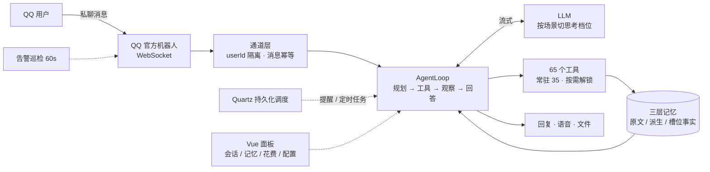

<div align="center">

# qq-agent

**部署在自己服务器上的 QQ 私聊长期陪伴 Agent**

65 个工具 · 三层长期记忆 · 多轮任务闭环 · 单实例线上运行

[](#)
[](#)
[](#)
[](#)
[](#)

</div>

---

> 它不是"接个模型回消息"的机器人，而是一个**跑在真实服务器上、有长期记忆、有工具、有预算上限、坏了会告警**的个人 Agent。
> 核心优先级：**用户长期记忆不丢失 > 系统稳定运行 > 交互体验友好**。

| 指标 | 数值 |
| --- | --- |
| 工具 | **65 个（21 类）**，默认只下发 35 个，缺了按需解锁 |
| 记忆 | **三层**：原文证据 / 派生画像 / 槽位事实；记忆评测 **28/28** |
| Agent 评测 | **19/19**（含任务级多轮：建提醒 → 读回 → 取消 → 校验落库为 0） |
| 首字延迟 | **9.1s → 2.6s**（首跳思考档位 high → medium） |
| 单轮成本 | 硬上限 **0.3 元**；每次调用落 `llm_call_audit`（场景 / token / 命中 / 费用） |
| 运行 | 单实例线上 · 每日 03:00 自动备份 · 推送即部署 + 部署后自检 |

## 它解决什么问题

| 陪伴类机器人的通病 | 这里的做法 |
| --- | --- |
| 记不住；或者记错了还在用旧的 | 三层记忆 + **事实取代链**：他说"课改到 15:00"，旧值标失效而不是删，召回只给新的 |
| 工具越加越多，模型越选越乱 | 65 个只常驻 35 个，缺的用 `discoverTools` 按需解锁（每轮省约 2.8k token） |
| 工具超时被当失败，重试把消息发两遍 | 失败分三级；超时记**"结果未知"**而不是失败；副作用工具带幂等键 |
| 一句话的事跑十分钟 | 思考档位按场景切：首跳 high 判断意图，对话档降到 minimal，单次 25~49s → **1.2~1.9s** |
| 账单失控 | 单轮 token + 金额双上限，超了收尾；按场景分开记账 |
| 挂了没人知道 | 60 秒巡检网关 / 数据库 / Redis / 调度 / 磁盘 / 堆 / 备份新鲜度，只在状态变化时推 QQ |

## 架构



## 关键设计

**① 记忆分三层，是为了"每层只解决一个问题"**

- `conversation_memory`：原文证据，**只追加、只能忘不能替**（审计与防幻觉的底）
- `memory`：派生画像与经验（`kind` = PROFILE / TASK / EXPERIENCE），可重写但带来源与 TTL
- `memory_fact`：单值事实 + **槽位取代链**，写时消解冲突，避免库里同时躺着两个"上课时间"

事实带 `origin`（STATED / INFERRED / EXTERNAL）与 `source_message_ids` 证据链：用户说"忘掉那次聊天"，按证据**级联标失效**而不是物理删除。

**② 工具按需下发，而不是全量塞进上下文**

65 个工具全部下发会吃掉首跳几 k token，还会让模型选错。现在默认只发 35 个核心工具，缺了让模型用 `discoverTools` 搜（本轮生效）。

**③ 失败分三级，只有第三级才值得反思**

`TRANSIENT`（超时 / 5xx，代码层退避）/ `FIXABLE`（参数错，原样回传给模型）/ `STRATEGIC`（连续失败或轮次过半）——只有第三类触发一次独立反思 + 重规划，每轮最多一次。

配套三件事：同参重复检测（防原地打转）、单工具执行时限（超时记 `UNKNOWN` 而非失败）、副作用幂等键（60s 内同参复用结果）。

**④ 延迟靠调参数，不靠改 Prompt**

生产日志显示对话调用的思考 token 占输出 **90~95%**（`ms=49238 输出=7014 其中思考=6703`），首字却只要 3~4 秒——说明慢在"想"不在"写"。于是改用请求体 `reasoning_effort` 按场景切档（8 档：`none/minimal/low/medium/high/xhigh/ultra/max`），对话降到 minimal 后质量评测 19/19 不变，单次耗时降了一个数量级。详见 [`docs/llm-call-modes.md`](docs/llm-call-modes.md)。

**⑤ 成本是可观测的，不是估的**

每次调用（含失败调用）都写 `llm_call_audit`：场景、流式与否、耗时、输入 / 输出 / 思考 token、缓存命中、金额。面板可按天、按场景看钱花在哪。

## 快速开始

```powershell
# 1) 基础设施（Docker Desktop 需先启动）
cd qq-agent
docker compose up -d mysql redis searxng     # 本地这份 compose 仍是 MySQL/Redis/SearXNG

# 2) 凭据：复制 .env.example 为 .env（已 gitignore），至少填 LLM_API_KEY
$env:LLM_API_KEY='…'

# 3) 起服务
mvn -DskipTests package
java -jar "target\qq-agent-0.0.1-SNAPSHOT.jar"
```

- 面板：<http://127.0.0.1:8080/>（Vue 单页应用；本机回环免口令）
- 前端是独立工程：`cd web && npm install && npm run dev`（Vite 5173 代理到 8080）；**要进 jar 必须先 `npm run build`**
- ⚠️ 本机 JAR 与远程容器**共用同一个 QQ AppID，不要同时运行**，否则双开抢网关

<details>
<summary><b>想端到端跑一轮「消息 → 模型 → 工具 → 回复」（点击展开）</b></summary>

生产是 QQ 通道，`/api/sim/*` 只在 `WECHAT_CHANNEL_MODE=simulator` 下注册。完整的一套（一次性 pg + redis、独立端口、不碰生产也不碰 QQ）写在 [`AGENTS.md`](AGENTS.md) §2 的「想端到端跑一轮」。

跑起来后：

| 接口 | 用途 |
|---|---|
| `POST /api/sim/send` | 同步纯文本，直接返回回复 |
| `POST /api/sim/qq/send` | 异步模拟 QQ 消息，可带 `images` / `attachments` / `quotedContent` |
| `GET /api/sim/replies?userId=…` | 取异步回复 |
| `GET /api/sim/memories` | 看该用户落下的记忆 |

每一轮工具往返都会写进 `conversation_memory` 的 `system` 行（`tool=<名> phase=result`）——这是判断"模型到底有没有调工具、成功还是失败"最快的证据来源。

</details>

## 功能模块

| 模块 | 包 | 说明 |
|---|---|---|
| 对话与工具循环 | `agent/` | 系统提示词逐字节静态（吃前缀缓存）；每轮注入当前时间与长期记忆 |
| 记忆（三层） | `memory/` | 原文证据 / 派生画像 / 槽位事实，见上文「关键设计 ①」 |
| 媒体记忆 | `media/` | 保存 / 检索 / 审阅删除；单任务读文件有上限；看完图要把"图里是什么"写回，否则以后搜不到 |
| 提醒 | `reminder/` | 解析 / 列表 / 取消 / 安全替换；到点只发一句话 |
| 定时任务 | `schedule/` | 到点**重跑一遍完整 Agent**（可搜索、可调工具）再发结果——和"提醒"不是一回事 |
| 面试陪练 | `interview/` | 题库 + 评分卡 + 复盘报告的模拟面试，不是"换个人设聊天" |
| 自主模块「它自己」 | `self/` | 独立作用域 `__self__`，只属于机主那一个号：自己的时间、自己的记录、1 GB 沙箱工作区 |
| 运维告警 | `alert/` | 60 秒巡检，只在"新出现问题或恢复"时推 QQ |
| 备份 | `backup/` | 每天 03:00 一个 zip + 媒体按 sha256 共享存一份 |
| 搜索 | `search/` | DeepSeek 搜索优先（每账号每天 30 次），超了落自托管 SearXNG |

## 技术栈

| 组件 | 选型 | 说明 |
|---|---|---|
| 框架 | Spring Boot 3.5 / Java 21 / Maven | |
| AI | LangChain4j + 自研 OpenAI 兼容 ChatModel（流式 + 非流式） | 任意兼容接口；当前默认 `deepseek-v4.1-flash-1017` |
| 存储 | **PostgreSQL 16 + pgvector** + Spring Data JPA | 2026-09 从 MySQL 8 整库迁来，见 `docs/pg-migration.md` |
| 缓存 | Redis | 上下文回退、消息幂等、主动消息日额度、任务状态 |
| 调度 | Quartz JDBC 持久化 | 提醒 / 定时任务重启自动恢复 |
| 搜索 | SearX-NG（自托管） | 只用实测可达的 6 个引擎 |
| 通道 | QQ 官方机器人 WebSocket | 唯一通道；每个用户独立上下文、记忆与文件目录 |
| 面板 | Vue 3.5 + Vite（`web/`） | 构建产物进 `src/main/resources/static/` |

## 项目结构

```
src/main/java/com/liche/qqagent
├── agent/        # 消息编排、对话循环、工具循环、提示词组装
├── alert/        # 运维告警推送
├── backup/       # 每日备份与备份新鲜度检查
├── channel/      # 通道抽象 + QQ 通道 + 模拟器 + 幂等 + 重连
├── command/      # 中文/斜杠指令解析与处理器
├── config/       # LLM 配置、场景档位、线程池、策略
├── controller/   # 面板 REST、模拟器、健康检查
├── document/     # PDF / DOCX 文本提取
├── interview/    # 面试陪练
├── media/        # 媒体授权、长期存储、检索、审阅删除
├── memory/       # 三层记忆、提取、向量召回、备份
├── metrics/      # 运行时指标
├── network/      # 出网安全（公开 URL 校验、DNS 固定）
├── reminder/     # 提醒实体/服务/解析/Quartz Job
├── schedule/     # 定时任务（重跑 Agent）
├── search/       # SearX-NG 客户端与搜索工具
├── self/         # 自主模块（判断 / 倾向 / 教训 / 它自己的作业）
├── tool/         # @Tool 注册表、策略、重试与失败语义
└── user/         # 用户档案（多租户）
```

## 部署

推送 `main` 自动触发 [`.github/workflows/deploy-remote.yml`](.github/workflows/deploy-remote.yml)：GitHub runner 构建镜像 → **HMAC 验签分片上传** → 服务器加载并只重建 `agent` 容器 → **部署后自检**（首页 / 前端资源 / 无口令 401 / 编码路径 401 / 带口令接口 / 登录 / 域名证书），任一项不符就推 QQ 告警并把流水线置红。

- 服务器 `/opt/qq-agent`，4 个容器 `qq-agent` + `qq-agent-{postgres,redis,searxng}`
- **数据卷任何情况下都不删除、不重建**
- Secrets、受限部署命令、验签细节见 [`docs/deploy-security.md`](docs/deploy-security.md)

## 文档

| 想看什么 | 去哪 |
|---|---|
| 踩过的坑（78 条，按主题索引） | [`docs/pitfalls.md`](docs/pitfalls.md) |
| Agent 循环：计划 / 失败分级 / 反思 / 预算 | [`docs/agent-loop.md`](docs/agent-loop.md) |
| 记忆三层与向量检索 | [`docs/memory-vector-plan.md`](docs/memory-vector-plan.md) |
| 记忆提取：触发、窗口、成本、信任分级 | [`docs/memory-extraction.md`](docs/memory-extraction.md) |
| LLM 调用档位与思考强度实测 | [`docs/llm-call-modes.md`](docs/llm-call-modes.md) |
| 评测怎么跑 | [`docs/eval.md`](docs/eval.md) |
| 给 AI 编码代理的项目记忆 | [`AGENTS.md`](AGENTS.md) |

## 已知限制

- 重复 Cron 提醒的预热只覆盖创建后首次触发
- 模拟器模式的推送要通过 `/api/sim/replies` 取，没有真实 QQ 触达
- 面板「日志」页与 `/metrics/history` 是**进程内**的，重启清零
- 备份与数据库在同一台机器同一块盘上，**扛得住容器重装，扛不住整机故障**（异地备份还没做）

## 配置

不在 README 里逐条列环境变量——那份清单会随代码腐坏。权威来源是 [`src/main/resources/application.yml`](src/main/resources/application.yml)（全部键 + 默认值 + 为什么这么设）与 [`docker-compose.remote.yml`](docker-compose.remote.yml) 的 `environment:`。

> ⚠️ compose 只透传 `environment:` 里列出的变量，漏一个就是"改了 `.env` 却不生效"，而且没有任何报错。

## License

暂未声明开源许可证。如需使用请先联系仓库作者。
